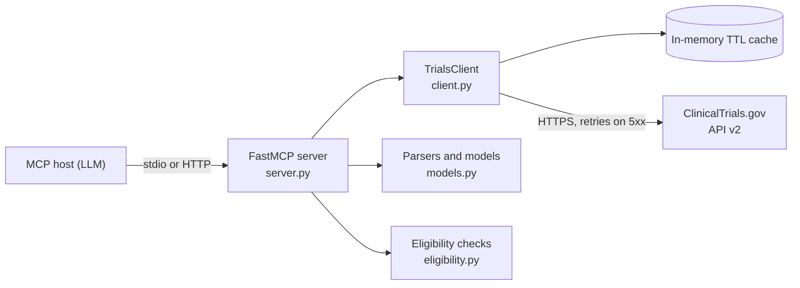

# Clinical Trials MCP Server

An MCP (Model Context Protocol) server that gives an LLM structured access to the public [ClinicalTrials.gov](https://clinicaltrials.gov) API v2. It wraps the registry in four typed tools: search studies, read one study in a normalized shape, check the deterministic part of a study's eligibility criteria for a patient, and list the sites that are actively recruiting. The registry needs no API key, and neither does this server.


## Architecture

The tool layer is thin. Each tool builds query parameters, calls one async client, and parses the response into a pydantic model. Everything except `server.py` is plain Python with no framework dependency, so the parsing and eligibility logic can be tested without starting a server.



- `client.py`: async httpx client with a timeout, bounded retries on 5xx and network errors, and a small in-memory TTL cache. Upstream failures become typed errors with short messages written for the calling model.
- `models.py`: pydantic output models and the parsers that flatten the API's nested `protocolSection` modules into them.
- `eligibility.py`: age and sex checks only. See the design decisions below for why the scope stops there.
- `errors.py`: the error types the client raises, kept separate so tool code never formats raw HTTP failures.

## Tools

### `search_trials`

Search the registry. At least one filter should be given; results come back with a total count and a page token for the next page. Page size is capped at 50 to keep responses small enough for a model context.

| Input | Type | Notes |
| --- | --- | --- |
| `condition` | string, optional | Condition or disease, matched by the API's own search |
| `intervention` | string, optional | Drug, device, or procedure name |
| `location` | string, optional | City, state, or country text matched against study sites |
| `phases` | list of string, optional | For example `["Phase 2", "Phase 3"]` |
| `statuses` | list of string, optional | For example `["RECRUITING"]` |
| `page_size` | int | 1 to 50, default 10 |
| `page_token` | string, optional | From a previous result's `next_page_token` |

Output: `total_count`, `returned_count`, `page_size`, `next_page_token`, and `trials`, where each trial has an NCT id, title, status, phases, conditions, intervention names, lead sponsor, and key dates.

### `get_trial`

Fetch one study by NCT number and return it in a normalized, readable shape.

| Input | Type | Notes |
| --- | --- | --- |
| `nct_id` | string, required | For example `NCT04354155` |

Output: titles, status, a short summary, phases, conditions, interventions with types and descriptions, an eligibility summary including the full criteria text, total and recruiting location counts, lead sponsor and collaborators, enrollment, and start, completion, and last update dates.

### `eligibility_check`

Check the deterministic eligibility criteria of a study for one patient.

| Input | Type | Notes |
| --- | --- | --- |
| `nct_id` | string, required | Study to check against |
| `age` | number, optional | Patient age in years (0.5 means 6 months) |
| `sex` | string, optional | `female` or `male` |

Output: a verdict of `meets`, `does_not_meet`, or `cannot_determine`, one result per check with a plain-language reason, and the study's full free-text criteria for human review. Only age and sex are checked, because those are the fields the registry reports in structured form. The verdict is not a final eligibility decision.

### `recruiting_sites`

List the sites of a study that are currently recruiting, with contact details where the registry provides them.

| Input | Type | Notes |
| --- | --- | --- |
| `nct_id` | string, required | Study to list sites for |
| `city` | string, optional | Only sites in this city |
| `state` | string, optional | Only sites in this state or region |
| `country` | string, optional | Only sites in this country |

Output: the study status, how many sites the registry lists in total, and the matching sites with facility, city, state, country, status, and contact name, phone, and email where listed. A site with no status of its own counts as recruiting when the study overall is recruiting, which matches how the registry presents it.

## Quickstart

Install and run locally (Python 3.11 or newer):

```bash
git clone https://github.com/Sairajiv-13/clinical-trials-mcp-server.git
cd clinical-trials-mcp-server
make setup
make test        # run the offline test suite
make run         # serve over stdio
```

`make run` starts the server on stdio. To connect a desktop MCP host, point it at the installed command:

```json
{
  "mcpServers": {
    "clinical-trials": {
      "command": "/path/to/clinical-trials-mcp-server/.venv/bin/clinical-trials-mcp"
    }
  }
}
```

Run it over HTTP with Docker instead:

```bash
docker build -t clinical-trials-mcp-server .
docker run --rm -p 8000:8000 clinical-trials-mcp-server
```

The HTTP server listens on port 8000 at the `/mcp` path. Without Docker, `make run-http` does the same on 127.0.0.1.

A minimal client that lists the tools and runs one search lives in [examples/minimal_client.py](examples/minimal_client.py):

```bash
.venv/bin/python examples/minimal_client.py
```

## Configuration

All configuration is through environment variables. Defaults work against the public API with nothing set. See [.env.example](.env.example).

| Variable | Default | Meaning |
| --- | --- | --- |
| `CT_MCP_BASE_URL` | `https://clinicaltrials.gov/api/v2` | API base URL |
| `CT_MCP_TIMEOUT_SECONDS` | `15` | Per-request timeout |
| `CT_MCP_CACHE_TTL_SECONDS` | `300` | How long a successful GET is cached; 0 disables the cache |
| `CT_MCP_MAX_RETRIES` | `2` | Extra attempts after a 5xx response or a network error |

## Testing

```bash
make test
```

The suite runs fully offline. HTTP calls are mocked with respx against response fixtures built from the documented API v2 schema, so no test needs network access or the live registry. The suite currently has 73 tests at 92% coverage of the package, covering search normalization and the page size cap, study parsing, the eligibility cases (below minimum, above maximum, sex mismatch, missing data), site filtering, and the failure paths (upstream 500s, retries, timeouts, unknown NCT numbers).

## Design decisions

Two architecture decision records live in [docs/adr](docs/adr):

- [ADR 0001](docs/adr/0001-fastmcp-and-two-transports.md): why FastMCP, and why the server ships both stdio and HTTP transports.
- [ADR 0002](docs/adr/0002-eligibility-deterministic-fields-only.md): why eligibility checks stop at the structured fields and return the free-text criteria for human review instead of trying to interpret them.

## Limitations

- Eligibility free text is returned, never parsed. Diagnosis requirements, lab thresholds, and prior treatment rules are in that text, so a `meets` verdict means the patient passes the age and sex fields only.
- Registry data is maintained by sponsors and can lag behind a study's actual state. Site recruiting status in particular changes without notice.
- The ClinicalTrials.gov API is a public service with rate limits and no uptime commitment. The client's retries and cache reduce load, but sustained heavy use should be discussed with the registry, not worked around.
- This server reads public registry data only. It does not handle protected health information, and the tools are not a substitute for a study team's eligibility review. Nothing here is medical advice.

## License

MIT. Copyright (c) 2026 Sai Rajiv Nagula. See [LICENSE](LICENSE).
